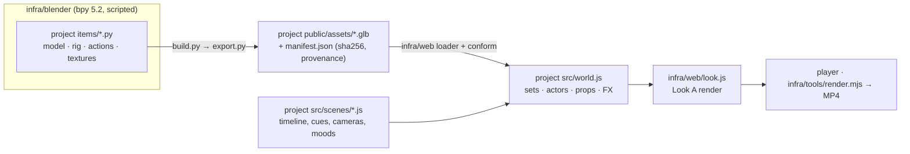

# 3d-object-world

Infrastructure for building **deterministic 3D scenes**:
- **Blender** builds the characters, sets and props. Each one is a Python script (Blender as a Python module), exported as a GLB "bank item".
- **Three.js** stages, animates, lights and renders them. Every frame is a pure function of time `t`, so a scene renders to the same video every time.

The first project built on it is **[Scene 001](samples/scene-001/README.md)**, a 13-second wordless short.

[](samples/scene-001/README.md)

## Repository layout

```
3d-object-world/
├── infra/                    # reusable infrastructure (no scene-specific code)
│   ├── blender/              # Blender → GLB bank pipeline
│   │   ├── build.py          #   builds a project's items/*.py into <project>/public/assets/*.glb + manifest.json
│   │   └── lib/              #   core (coords, join, modifiers) · geo · mat (material families) · tex · rig · export
│   ├── web/                  # Three.js engine modules, imported as `@infra/...`
│   │   ├── look.js           #   Look A: renderer, lights, shadows, GTAO, bloom, vignette, per-frame moods
│   │   ├── loader.js         #   GLB loading + conform.js (material families)
│   │   ├── rig.js            #   deterministic clip layering / blending (no running mixer clock)
│   │   ├── actor.js · camera.js · math.js (easing, seeded noise, springs)
│   │   └── ui/               #   player UI (play/pause, frame step, beats, free camera)
│   └── tools/                # headless capture, MP4 export, preview compression, probes
├── samples/
│   └── scene-001/            # first sample project (see its README)
│       ├── items/            #   Blender item scripts: characters, sets, props
│       ├── src/              #   scene code: world, actors, props, sets, timeline, director
│       ├── public/assets/    #   built GLBs + manifest.json (sha256 + provenance)
│       ├── docs/             #   scene spec
│       └── media/            #   rendered video, preview, stills
├── docs/
│   ├── pipeline.md           # how the pieces fit, determinism, adding a new project
│   ├── conventions.md        # bank contract: coordinates, names, materials, rigs, actions, decals, spots
│   ├── tools.md              # every tool with examples
│   └── analysis.md           # pros/cons, effort, alternatives, mixing in AI-generated footage
├── vite.config.js            # one config for all projects (PROJECT=samples/<name>)
└── package.json
```

## Quick start

```bash
npm install
python3 -m venv .venv && ./.venv/bin/pip install bpy==5.2.0 pillow imageio-ffmpeg numpy   # Blender as a Python module
npm run assets          # build every bank item of the default project (samples/scene-001)
npm run dev             # http://127.0.0.1:5173 — the scene player
npm run render          # out/scene-001.mp4 (needs `npm run dev` running)
```

You'll also need Google Chrome installed, since the headless capture uses it; set `CHROME_PATH` if it isn't in `/Applications`. To work on another project, set `PROJECT=samples/<name>` for `npm run dev`, `npm run assets` and `npm run build`.

## How it works



- **Bank items are code.** Each GLB comes from a deterministic Blender script. The manifest records each GLB's sha256 and provenance (Blender version, script path, script sha256). The exporter puts triangles in a canonical order, so rebuilding unchanged items gives the same bytes. There's one known exception, listed below.
- **Rigs** use bones that point straight up with roll 0, so every joint has an identity rest rotation in Three.js and the joint axes are the character axes. **Actions** are Blender actions exported as glTF animations. `infra/web/rig.js` layers and blends them as a pure function of `t`.
- **Look A** (`infra/web/look.js`): neutral tone mapping, fog, room environment, hemisphere + key + rim lights, PCF shadows, MSAA ×4, GTAO, bloom and vignette. `Look.setMood()` lets a scene change exposure, colours and lights per frame.
- **Scenes** are config + a director: a timeline of beats and cues, `camera(t)`, `mood(t)`, and choreography that poses every actor and prop from `t` alone.

More detail: [docs/pipeline.md](docs/pipeline.md) · [docs/conventions.md](docs/conventions.md) · [docs/tools.md](docs/tools.md).

## Video size

`npm run render` encodes H.264 at **CRF 23** with `-tune animation`. That's visually clean for this flat-shaded toy look, and Scene 001's 13 s at 1080p30 comes out at **≈6 MB**. Options:

| Flag | Use | Scene 001 (13 s, 1080p) |
|---|---|---|
| *(default)* `--crf 23` | Sharing, README, review | ≈6 MB |
| `--crf 26` | Smaller previews | ≈4 MB |
| `--master` (CRF 16) | Near-lossless master for editing or grading | ≈18 MB |
| `--webp` | Also writes a 640 px animated WebP for READMEs | ≈2.7 MB |

3D renders compress well (smooth shading, little noise), so 18 MB was only the near-lossless setting. You don't have to accept that size.

## Samples

| Project | What it shows |
|---|---|
| [Scene 001](samples/scene-001/README.md): *locked in → the lioness → dishes → the idea fades* | 3 rigged characters (with shell fur on the plush mascot), 2 dollhouse sets, face decals, IK, a per-plate dishwashing cycle, mood lighting, multi-shot cameras |

## Known issues

- One office mesh can be exported with a slightly different accessor layout between builds. The geometry and the rendered pixels are identical, but that GLB's sha256 can change on a rebuild.
- The headless capture is tuned for macOS (`--use-angle=metal`). On other platforms, adjust the Chrome flags in `infra/tools/*.mjs`.
