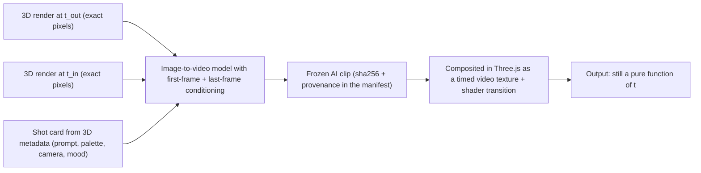

# Scene 001 in 3D: analysis, effort, and mixing in AI footage

This note compares the Three.js + Blender/GLB build in this repo with two earlier prototypes of the
same scene, measures what the build cost, lists the lessons that carry to any engine, and looks at
routes that don't need this 3D stack and at mixing AI-generated images and footage into the video.

| See also | |
|---|---|
| [`samples/scene-001/`](../samples/scene-001/README.md) | The sample project: items, scene code, assets |
| [`scene-spec.md`](../samples/scene-001/docs/scene-spec.md) | The full scene spec (timeline, cues, look, characters, sets, cameras) |
| [`infra/`](../infra/) | The reusable Blender → GLB pipeline, the Three.js engine modules and the tools |

## 1. Approaches compared

Two earlier prototypes of Scene 001 came before this build. The 2.5D animatic set the quality bar.

| | **2.5D cut-out animatic** (the quality bar) | **Primitive-mesh 3D prototype** | **This build: Three.js + Blender/GLB** |
|---|---|---|---|
| How it's made | Layered flat drawings, a bank of poses and expressions, scene files with fixed camera presets | Every mesh built in code from primitives (spheres, lathes, rounded boxes); sine-curve motion | Blender scripts model, rig and animate each item and export GLB; Three.js stages, lights and renders |
| Look ceiling | High for a drawn style: hand-drawn expressiveness | Low: lumpy hair, a flat apron, a lioness that looks assembled from primitives | Medium-high: soft vinyl toy, plush fur, mood lighting. Still a code-sculpted look, not an artist's sculpt |
| Camera | Fixed presets (push, truck); no real angle change | Free 3D camera | Free 3D camera plus inspection cameras; sets framed so no shot looks into the void |
| Physical actions (door, point, dishes) | Suggested by drawings; cheap and readable | Weak | **Real**: IK arms, an aimed point, a plate that travels, water, foam, a tap |
| Consistency across shots | Good: the same drawings | Good | **Excellent**: the same model, rig and lighting in every shot and every scene |
| Determinism / re-render | Yes | Yes | Yes; 390 frames render in about 50 s |
| Cost of a change | Redraw the asset | Edit code | Edit a parameter or script, rebuild the GLB in seconds, re-render |
| Reuse for later scenes | Medium (poses are per angle) | Medium | **High**: characters, rigs, sets and actions form a bank |

## 2. Pros and cons of the 3D build

| Pros | Cons and risks |
|---|---|
| **Acting and logic:** gestures that actually aim (the point hits Tim's head), cause and effect (the same plate goes stack → wash → rack), planted feet | **Big upfront cost:** about 14.4k lines of code before the first scene looked right |
| **Free cinematography once the world exists:** new shots, inserts and cuts are a few lines in `cameraAt(t)`. Beat 2 became three shots without new assets | **Sculpting by code has a ceiling:** hair, fur and faces took several passes and still read as code-built next to an artist's sculpt |
| **Light carries the story:** one mood table turns the same sets from warm and focused to cold and drained | **Every new action is engineering:** the dish cycle alone needed IK, a choreography module, kitchen rebuilds and camera changes |
| **A bank, not a one-off:** Tim, the lioness, GuoGuo, the office and the kitchen carry over to later scenes | **Look gap against the 2.5D bar:** drawn tricks (squash, smears, speed lines) are cheap in 2D and costly in 3D; face decals help but aren't as fluid |
| **Everything is data:** every frame is a pure function of `t`, with known cameras, poses, palettes and cues. This makes AI integration much easier ([section 6](#6-mixing-ai-generated-images-and-footage)) | **Review cost:** visual review runs on screenshots; full-size frames are heavy, so previews must be compressed |
| **Deterministic re-renders:** the same `t` gives the same pixels, in any frame order | **Asset size:** characters sit at about 3 MB per GLB |

## 3. Effort

### Measured for this repo

| Measure | Value |
|---|---|
| Code | **≈ 14.4k lines**: ~9.5k Blender Python (pipeline + item scripts), ~4.4k JavaScript (engine + scene), ~0.4k tools |
| Bank | 7 GLBs (3 characters, 2 sets, 2 props), **15 MB** in total, each with sha256 and provenance |
| GLB rebuild | Seconds per item (about 4 s for a typical one) |
| Full render | 390 frames (13 s at 1080p30) in **≈ 50 s** |
| Video size | ≈ 6 MB at H.264 CRF 23 (the default), ≈ 18 MB for the CRF 16 master |
| Development time | **≈ 1.5 working days** over three review rounds: a first full build (pipeline, engine, bank, first full scene), then two quality passes (staging, light moods, character rebuilds; then the dish logic, GuoGuo, the walk, FX and set extensions) |

### Relative effort (estimated)

| Approach | Scene 001 | Later scenes (marginal) |
|---|---|---|
| 2.5D cut-out animatic | **1×** (baseline) | ~1× per scene (new angles need new drawings) |
| Primitive-mesh 3D | ~1–1.5× | ~0.7× |
| **Three.js + Blender/GLB** | **~3–5×** (mostly the one-off pipeline and bank) | **~0.5–1×** when it reuses the characters and sets; a new set or many new actions push it toward 1.5× |

The 3D path costs a lot up front, then pays off in reuse, camera freedom and physical logic. It's
worth it for a series of scenes with the same cast. For a single short, the 2.5D animatic gives similar
storytelling value for less.

## 4. What made the difference

The first full 3D build moved every asset to Blender, yet on screen it hardly looked better than the
primitive prototype: the cameras hid the acting. Most of the improvement in the two quality passes came
from ideas that work in any engine:

| Lesson | What it meant in Scene 001 |
|---|---|
| **Stage so faces and gestures read** | Shoot the face, not the back of the head: ¾ front push-in on the focused face; the lioness cheated to near profile so the pointing arm reads side-on; a hands insert so the chore reads; a frontal push-in on the slump. Lift the face a few degrees toward the lens in each beat |
| **Mood light per beat** | A warm, focused office (room dimmed, a warm practical on Tim) → daylight snaps back on the burst → a cool kitchen that keeps dimming → extra dim once the bulb dies. Same sets, different story |
| **Readable FX** | Effects big and contrasted enough to see at a glance: dark ink speed lines over light walls, a visible anger mark, door dust tinted to read on both the white door and the floor, a darker smoke wisp, a cool halo blended normally (additive vanished on the pale tiles) |
| **Physical logic** | The dish cycle: grab → dip → scrub (dirt fades) → rinse under the running tap → rack. The same plate travels stack → hand → rack; stack 6 → 3 and rack 0 → 3 on the cue times; the island at Tim's working height so his arms can reach. Nothing vanishes or pops in |
| **Determinism** | A frame-order bug: Tim's head-turn read the lioness's posed head, but she is posed after him, so it held the previous frame's pose; the bulb anchor was smoothed against the last frame. Scrubbing or rendering out of order gave different pixels. Fix: everything read across actors is a pure function of `t` (her path is computed from `t`; reference head positions are computed once at load) |
| **Small previews for quick review** | Raw frames are 2–3.5 MB each. Contact sheets and stills are compressed by default (≤ 1280 px, ≤ 250 KB), so a whole timeline can be reviewed at once and often |

## 5. Alternative routes without this 3D stack

If you keep an existing 2.5D or primitive-3D pipeline, these are the options:

| # | Scenario | Effort per new scene (2.5D = 1×) | Look | Best for |
|---|---|---|---|---|
| **S1** | **Pure 2.5D:** keep making scenes like the animatic | **1×** | The accepted bar: expressive and drawn | Fast output, many scenes |
| **S2** | **2.5D + AI images as layers:** AI paints layer art (backgrounds, props, pictograms) | **~1×** (+ minutes per image) | Richer backgrounds, same characters | Upgrading the look cheaply |
| **S3** | **2.5D spine + 3D hero shots:** 3D only where a camera move or a physical action matters | ~1.3× | Mixed; the hand-off between styles must be planned | Moments that need a real camera |
| **S4** | **Primitive 3D engine + frozen GLB parts from this repo:** replace only the weak primitives with frozen GLBs | ~1.2× after a one-time import | Fixes hair, apron and lioness without a new engine | Making primitive 3D the main path |
| **S5** | **Primitive 3D with these lessons ported** (staging, mood light, FX, choreography), keeping its assets | ~1.1× | Better staging, still primitive-looking characters | Small, quick improvements |

| # | Pros | Cons |
|---|---|---|
| S1 | Cheapest and most expressive (squash, smears, drawn speed lines); wordless pictograms are trivial | Fixed camera presets; physical actions only suggested; new angles need new drawings |
| S2 | The easiest place to use AI: an AI image is just another flat layer, with no 3D lighting to match and no transition risk; fits "generate, pick, freeze" | AI likes to add text (breaks the wordless rule), so every image needs a check; style and palette drift; characters should stay from the bank |
| S3 | 3D only where it pays | Two looks in one film; every switch needs a motivated transition (cut, white flash, smoke) and matched palette and light; two banks to maintain |
| S4 | No new engine: the existing one stays the system. Tim, the lioness and GuoGuo drop in as frozen GLB parts with sha256, and the weak points disappear | The engine needs a GLB part type with skinning and animation clips, and the rigs and actions must map onto its pose system: the main one-time cost |
| S5 | Most of the visible improvement here came from engine-level ideas that don't depend on assets ([section 4](#4-what-made-the-difference)) | The characters keep their primitive look: only half the improvement |

**What carries over without this stack:**

| Take | Form | Into |
|---|---|---|
| GLBs for Tim, the lioness, GuoGuo, the dishes and the kitchen | Frozen files + `manifest.json` (sha256, provenance) | GLB parts in a primitive-3D engine (S4) |
| Staging, mood and FX rules; the dish-cycle spec | Written rules and numbers ([scene spec](../samples/scene-001/docs/scene-spec.md)) | 2.5D or primitive-3D scenes (S1, S3, S5) |
| Preview compression | [`infra/tools/compress.py`](../infra/tools/compress.py) + the preview budget | Any visual review loop |
| Prompts from scene metadata | The method ([section 6](#prompts-from-3d-metadata)) | S2 and S3 (scene files hold the same data) |

**Recommendation:** to ship scenes fast, **S1 + S2**: keep the 2.5D route and add AI images as layers.
To keep a 3D track without this stack, **S4**: add a GLB part type to the primitive engine and import
the improved characters as frozen GLBs, then port the staging and choreography lessons (S5). This repo
then serves as the factory for those parts.

## 6. Mixing AI-generated images and footage

### Integration patterns (smoothest to riskiest)

| # | Pattern | Example in Scene 001 | Smoothness | Consistency risk | Effort |
|---|---|---|---|---|---|
| A | **AI image as a texture inside 3D** | Wall painting, window sky, laptop "app" art, bubble pictogram, ✗ card art | Seamless (lit by the 3D lights) | Very low | Low |
| B | **AI background plate behind 3D** | A garden outside the kitchen window, the hall | Seamless if the camera moves little | Low | Low–medium |
| C | **Hard cut / match cut to an AI insert** | A 1.5 s "dream of the app" insert in beat 1 | A cut is always clean; the style must match | Medium | Medium |
| D | **Smooth 3D → AI → 3D transition** | Push into the bulb → white-out → AI idea montage → white-out → back on Tim | Smooth if done right (below) | Medium–high | Medium–high |
| E | **AI restyle of 3D renders** (video-to-video with depth/pose control) | A painterly version of a shot | Can flicker or drift | High (identity) | High |

### Smooth 3D → AI → 3D transitions



1. **Pin both ends to real frames.** Give the model the exact 3D render at the out-point as the first
   frame and the render at the re-entry point as the last frame. The clip then starts and ends
   pixel-matched; a 4–8 frame dissolve hides what's left.
2. **Use motivated transitions that are easy to match:**
   - **light:** the bulb blooms to white, then white back to the scene (a white frame is trivial to match);
   - **smoke or steam:** the beat-4 smoke wisp fills the frame;
   - **shape match:** plate → full moon → the ✗ card;
   - **camera move:** a whip pan with motion blur.
3. **Keep the characters in 3D.** AI video still drifts on identity (Tim's glasses and dead-fish eyes,
   GuoGuo's markings) and mangles physical logic (hands, plates). Give AI the abstract, imaginative and
   environmental content, with no characters or only silhouettes.
4. **Composite in-engine, not in an editor.** Load the frozen clip as frame textures and blend it with
   a shader in Three.js. The renderer then still gives the same video for the same `t`, so the output
   stays deterministic.
5. **Freeze picks.** Generate options, pick one, and store it with its model, version, seed, prompt and
   sha256, like the GLB manifest.

### Pros and cons

| Use | Pros | Cons |
|---|---|---|
| Textures and plates (A, B) | Rich detail for almost no effort; no continuity problems; fixable per asset | AI tends to sneak in **text** (breaks the wordless rule), so every image needs a check; the style must match Look A's palette |
| Inserts and transitions (C, D) | Imagination shots that are very costly in 3D (the app idea blooming, a dream montage); a big lift for a few seconds | Hard to time to frame-exact cues; a style jump if the prompt drifts; ~5–10 generations per usable clip; unrepeatable after model updates unless frozen; licensing and provenance to track |
| Restyling (E) | Could lift the whole look in one go | Flicker, identity drift, the dish logic gets re-imagined wrongly, high compute; it fights the strengths of the 3D build |

### Scene 001 opportunities

| Where | What | Pattern | Transition |
|---|---|---|---|
| Beat 1, 1.6–2.6 s | "The app idea": glowing UI pieces and a rocket of code blocks blossoming out of the bulb | D | Push into the bulb → bloom white → AI clip → white → back on Tim |
| Office window, painting, laptop screen | AI-painted landscape, painting, wordless app UI | A | none |
| Kitchen window, beats 3–4 | A dusk garden that dims with the mood | B | none |
| Beat 4, 10.9–11.9 s | The idea dissolving into smoke: the shapes from beat 1 drifting apart | D | The smoke wisp fills the frame → AI → the smoke clears into the ✗ card |
| Before beat 1 (optional, +2 s) | Establishing shot of the house at night with one lit window | C | Match dissolve: the window → the dollhouse office |

### Prompts from 3D metadata

Most of what a prompt needs already lives in the scene code:

| Prompt field | Where it lives |
|---|---|
| Shot size, angle, lens | `cameraAt(t)`: position, target and FOV give framing, height and an equivalent focal length |
| Subject and action | Beat name, the cue table, active clips per actor (`sit_type`, `stand_wash`, …), expression per `t` |
| Set and props | Set per `t`, spot names, prop state (stack count, rack count, bulb level, tap on/off) |
| Look and palette | Look A, `moodAt(t)` (warm focus, cool kitchen), palette hex values from the spec and the material families |
| Characters | Spec text plus turnaround renders as **reference images** |
| Rules | Wordless → a negative prompt for text, letters and watermarks; style: "3D toy, Animal Crossing smooth, Sylvanian dollhouse" |
| Timing | Beat start/end and cue times give the clip length and the first/last frame times |

Real data from the scene at **t = 3.3 s**, read from the running page:

```json
{ "t": 3.3, "beat": "1 Locked in", "set": "office",
  "narration": "I was locked in, building an app with my agent…",
  "cam": { "pos": [1.65, 1.72, 3.45], "target": [0.57, 1.29, -0.41], "fov": 22 },
  "timHead": [0.85, 1.12, -0.43] }
```

A shot-card exporter turns that into a prompt. FOV 22° is about a 62 mm lens; the camera is 0.43 m
above the target, 4 m out and to the right, so it reads as a slightly high ¾ medium close-up:

> *Slightly high three-quarter medium close-up, 62 mm lens, of a chibi villager figure in a navy hoodie
> and thin round glasses typing at a laptop on a wooden desk, warm focused glow, dim cosy dollhouse
> office with cream flower-dot wallpaper and sage wainscot, a glowing light bulb above his head, palette
> #efe5d1 #b9c3a8 #36435e #ffe2a0, soft vinyl toy look, Animal Crossing / Sylvanian Families style,
> shallow depth, 1920×1080, 30 fps, 1.0 s.*
> **Negative:** text, letters, numbers, watermark, logo, realistic human, harsh contrast.
> **Conditioning:** first frame `render(t=1.6)`, last frame `render(t=2.6)`, references
> `tim_views.jpg`, `guoguo_views.jpg`.

**Control passes.** The engine can also render per-shot depth, normals, per-object masks and a pose
skeleton (override materials on the same camera). Most image and video models accept these for layout
and motion control, so an AI insert follows the same camera move as the 3D shot.

### Effort to add an AI layer (estimate)

| Piece | Effort |
|---|---|
| Shot-card exporter: shot card + prompt + first/last frames for any `t` range | ~0.5 day |
| Control-pass render mode (depth / normal / mask / pose) | ~1 day |
| In-engine video-texture compositing + transition shaders (white bloom, smoke wipe, dissolve), still deterministic | ~1 day |
| AI asset manifest (model, version, seed, prompt, sha256, picks) + a "no text" check | ~0.5 day |
| **Pipeline total** | **~3 days, once** |
| Each texture or plate | Minutes (generate, pick, freeze) |
| Each 1–2 s transition insert | ~1–3 h, mostly generation rounds and picking |

## 7. Recommendation

1. **Keep 3D as the spine** for characters, acting and anything physical. That's what made the scene
   make sense, and it's reusable.
2. **Add AI where 3D is weak or expensive:** imagination, abstract and atmospheric content, and
   backgrounds. Use light- or smoke-motivated transitions pinned to exact first/last frames, and
   composite in-engine to stay deterministic.
3. **Build the shot-card exporter first** (half a day). It makes prompting systematic and helps with
   storyboards and briefs too.
4. **Pilot one insert**, "the app idea" in beat 1, before committing to more.
5. **Without this stack:** S1 + S2 to ship fast; S4 + S5 to keep a 3D track ([section 5](#5-alternative-routes-without-this-3d-stack)).
