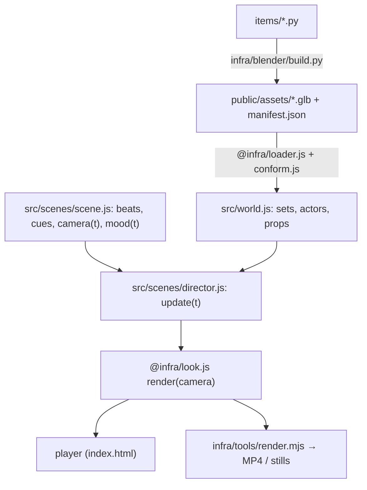

# Pipeline

How a project goes from Python scripts to a rendered video, and how to start a new project.

## 1. The pieces

| Layer | Where | Role |
|---|---|---|
| Item scripts | `<project>/items/*.py` | Model, rig, animate and texture one bank item in Blender (as a Python module). Deterministic: seeded randomness only |
| Shared Blender helpers | `infra/blender/lib/` | Coordinates (`B()` converts three.js → Blender), geometry, material families, numpy textures, rigs and actions, GLB export |
| Builder | `infra/blender/build.py` | Runs items in a fresh scene, exports GLBs, writes `manifest.json` (sha256 + provenance) |
| Bank | `<project>/public/assets/` | GLBs + manifest, served by Vite |
| Engine | `infra/web/` (`@infra/...`) | Look A renderer and moods, GLB loading + material conform, deterministic rig layering, camera rig, math, player UI |
| Scene code | `<project>/src/` | World (which GLBs, where), actor/prop/set wrappers, the scene config (timeline, cues, `camera(t)`, `mood(t)`) and the director (choreography) |
| Tools | `infra/tools/` | Headless capture, MP4 export, preview compression, probes ([tools.md](tools.md)) |



## 2. Determinism

A frame must depend only on `t`:
- **No wall clock and no running mixer.** `infra/web/rig.js` samples clips with interpolants at `t`, and the director computes every pose, position and effect from `t`.
- **Seeded randomness only**, frozen into tables at load time (e.g. a bulb flicker table from `rng(seed)`).
- **No dependence on the previous frame.** If actor A looks at actor B, compute B's position from `t` (e.g. a `pathAt(t)` helper); don't read B's pose from the last frame.
- **Warm-up renders** compile every shader before the first captured frame.
- **Test:** render `t`, render other times, render `t` again. The PNGs must be byte-identical.

The builder is also reproducible. Item scripts are seeded, and `export.py` puts each primitive's triangles in a canonical order, so unchanged items rebuild to the same bytes. The one exception is listed in the README.

## 3. A scene config

The player (`src/main.js`) expects the director to return an object like this:

```js
{
  id: '001', title: '…', duration: 13.0, fps: 30,
  beats: [{ id, name, start, end, set, camera, narration }],
  cues: { … },                       // named times
  stills: { name: t, … },            // key moments for render.mjs --stills
  camera(t) { return { position, target, fov }; },
  update(t, camera) { /* pose the world */ },
  beatAt(t) { … },
}
```

The scene config can also supply `mood(t)`, which the director passes to `Look.setMood()` every frame (exposure, background/fog, hemisphere/key/rim lights, a practical spot, vignette).

## 4. Starting a new project

1. **Copy the skeleton:** `samples/<name>/` with `index.html`, `viewer.html`, `items/__init__.py`, `src/main.js`, `src/world.js`, `src/scenes/<scene>.js`. Scene 001 is the reference; copy only what you need.
2. **Write items** following [conventions.md](conventions.md): `ITEM = {"id": "characters/x", "out": "characters/x.glb"}` and `build()`. Import shared helpers with `from lib import core, geo, mat, rig, tex`. Helpers without `ITEM` are skipped by the builder.
3. **Build:** `PROJECT=samples/<name> npm run assets`.
4. **Run:** `PROJECT=samples/<name> npm run dev`, then check items in `/viewer.html?asset=…&sheet=views`.
5. **Write the scene:** beats and cues, `camera(t)`, `mood(t)`, then a director that poses everything from `t`.
6. **Review** with compressed contact sheets (`infra/tools/shot.mjs … --t a,b,c --sheet 3`) and inspection cameras (`--cam/--target/--fov`).
7. **Render:** `npm run render -- --webp --out samples/<name>/media/<name>.mp4`, then add a README that shows the preview (see [Scene 001's README](../samples/scene-001/README.md)).

## 5. Lessons from Scene 001

- **Stage for readability:** faces toward the lens, gestures side-on, a close-up insert for detailed actions.
- **Light carries the story:** a mood per beat matters as much as the models do.
- **Physical logic:** objects travel through hands (the same plate goes stack → wash → rack); nothing pops in or out.
- **Effects must read at preview size:** test them in compressed sheets, not just at full size.
- See [analysis.md](analysis.md) for the full write-up.
