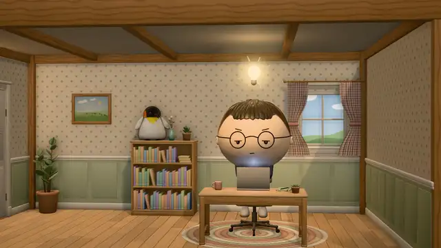
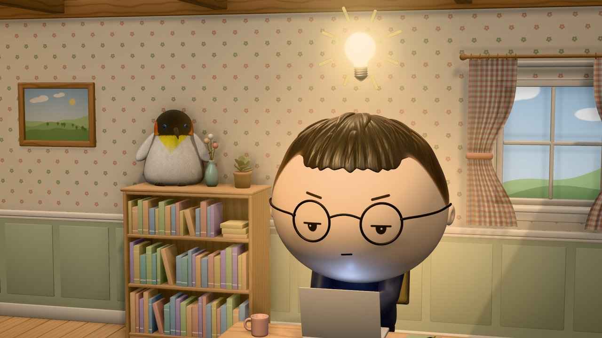
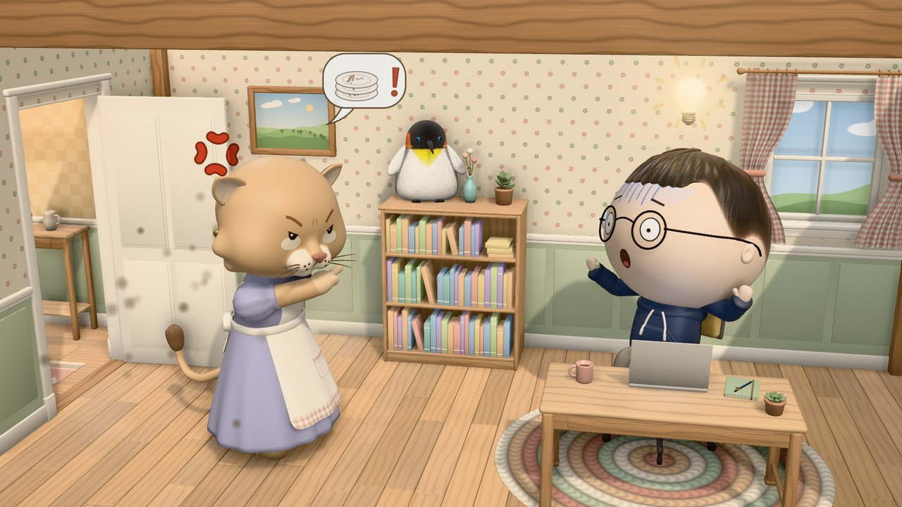
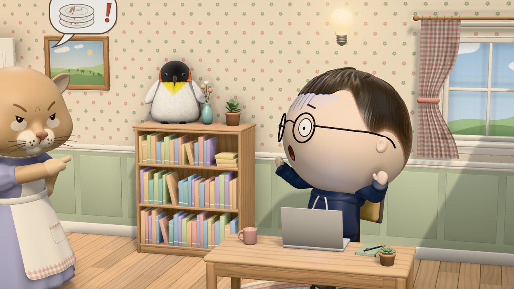
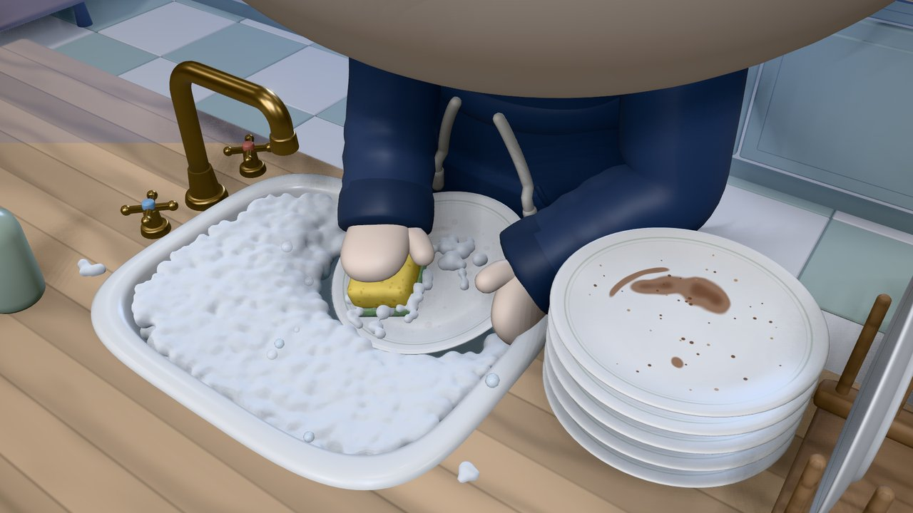
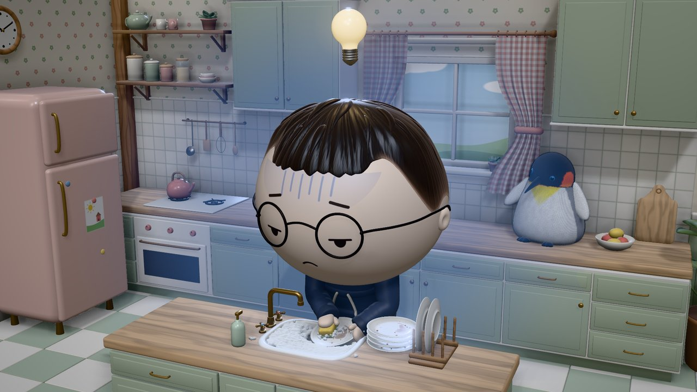
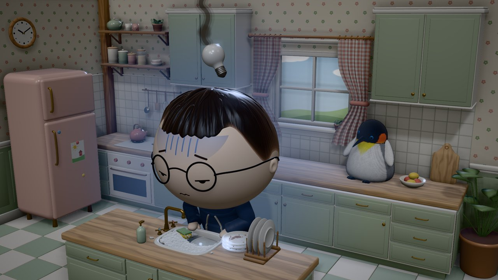
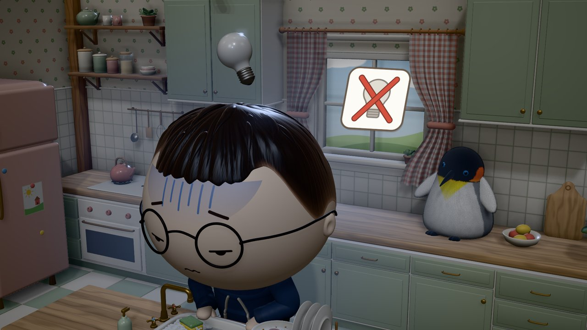

# Scene 001 · Locked in → the lioness → dishes → the idea fades

The first sample project built on the [3d-object-world infrastructure](../../README.md). It's a 13-second wordless short at 1920×1080 and 30 fps (390 frames), rendered deterministically from Blender-built GLBs in Three.js.

> *"I was really locked in on building an app with my AI agent, but my wife (a fierce lioness) burst into the room and told me to do the chores (washing dishes). While I was doing that, the light bulb (the idea) in my head faded out."*

## Watch

[](media/scene-001.mp4)

**▶ [scene-001.mp4](media/scene-001.mp4)** (H.264, 1080p30, 6.2 MB). The animated preview above is a 640 px WebP; click it for the full video.

<video src="media/scene-001.mp4" poster="media/stills/b1_locked_in.jpg" controls muted width="100%"></video>

## The four beats

| # | Time | Beat | Still |
|---|---|---|---|
| 1 | 0.0–3.5 s | **Locked in.** Tim types at his desk, focused, with a warm glow and a bright idea bulb. The camera pushes in from a wide of the whole dollhouse office |  |
| 2 | 3.5–6.2 s | **Break-in.** The door bursts open (speed lines, dust). The lioness strides in, plants a paw on her hip and points; the bubble shows dirty plates. Hard cut to Tim's shock while the bulb flickers |   |
| 3 | 6.2–9.7 s | **Dishes.** In the kitchen, Tim washes plate after plate: grab, dip, scrub (the dirt fades), rinse under the tap, rack. The stack goes 6 → 3, the light turns cool, the bulb dims. A close-up shows his hands |   |
| 4 | 9.7–13.0 s | **Idea gone.** He gives up: the plate slides into the water, the tap goes off, he slumps. The bulb flickers once, goes out and lets off a smoke wisp, then a crossed-out-bulb card pops in |   |

GuoGuo, the king-penguin plush mascot, is in every beat: on the bookshelf in the office, on the counter in the kitchen.

## Run it

From the repository root:

```bash
npm install && python3 -m venv .venv && ./.venv/bin/pip install bpy==5.2.0 pillow imageio-ffmpeg numpy
npm run assets                     # build all bank items → samples/scene-001/public/assets (≈20 s)
npm run dev                        # http://127.0.0.1:5173
npm run render                     # out/scene-001.mp4 (≈50 s)
```

**Player** (`/`):
- **Keys:** Space play/pause · ←/→ frame step (⇧ = 1 s) · 1–4 jump to a beat · **C** shot ↔ free camera · **R** reset the free camera · L loop · H hide the UI.
- **Free camera:** drag = orbit, right-drag = pan, wheel = dolly, alt + wheel = zoom.
- **URL options:** `?t=4.2`, `?cam=free`, `?q=half`, `?scene=beat2` (the 8 s break-in clip on its own).

**Bank viewer** (`/viewer.html?asset=characters/tim.glb`) shows any GLB under Look A. Options: `sheet=views`, `sheet=action&action=walk`, `expr=shock`, `bones=1`, `spots=1`, `decal=grid`, `cam=…&target=…`.

```bash
./.venv/bin/python infra/blender/build.py lioness                                   # rebuild one item
node infra/tools/shot.mjs "/viewer.html?asset=characters/guoguo.glb&sheet=views" preview/gg.jpg
node infra/tools/shot.mjs "/?render=1" preview/sink.jpg --t 7.4 --cam 0.45,1.45,0.95 --target 0.38,0.6,-0.12 --fov 35
node infra/tools/render.mjs --stills                                                # out/stills/*.png at the key moments
```

## What's inside

| Path | Contents |
|---|---|
| [`docs/scene-spec.md`](docs/scene-spec.md) | **The full spec**: premise, rules, timeline and cues, the dish cycle, Look A and light moods, characters, sets, props, cameras, built assets |
| [`items/`](items/) | Blender item scripts. Characters: [`tim.py`](items/tim.py) (+ [`tim_hair.py`](items/tim_hair.py)), [`lioness.py`](items/lioness.py) (+ [`lioness_walk.py`](items/lioness_walk.py)), [`guoguo.py`](items/guoguo.py). Sets: [`office.py`](items/office.py) (+ [`office_props.py`](items/office_props.py)), [`kitchen.py`](items/kitchen.py), shared [`dollhouse_kit.py`](items/dollhouse_kit.py). Props: [`bulb.py`](items/bulb.py), [`dishes.py`](items/dishes.py) |
| [`src/scenes/scene001.js`](src/scenes/scene001.js) | Timeline, cues, bulb curve, per-beat cameras and light moods |
| [`src/scenes/director.js`](src/scenes/director.js) | Choreography: poses every actor, prop and effect as a pure function of `t` |
| [`src/scenes/dishwash.js`](src/scenes/dishwash.js) | The per-plate dish cycle with two-bone IK; the same plate travels stack → hand → rack |
| [`src/actors/`](src/actors/) | Face decals (canvas-drawn expressions), GuoGuo's shell fur |
| [`src/props/`](src/props/) | Idea bulb, laptop screen, FX (speed lines, anger mark, dust, glows, sweat, card, water) |
| [`src/sets/`](src/sets/) | Office (door spring, chair) and kitchen (stack, rack, foam, tap) wrappers |
| [`public/assets/`](public/assets/) | Built GLBs + [`manifest.json`](public/assets/manifest.json) (sha256, Blender version, script, script sha256) |
| [`media/`](media/) | The rendered MP4, animated preview and stills |

## Bank

| Asset | GLB | Notes |
|---|---|---|
| Tim | `characters/tim.glb` (2.8 MB) | Chibi villager, textured-crop hair with a fade, wire glasses, hoodie, mitten hands; FK rig; `sit_type`, `sit_shock`, `stand_wash`, `stand_sink_idle`, … |
| Lioness | `characters/lioness.glb` (3.0 MB) | Feline head with a 3D muzzle, cheek ruffs, apron dress, paws with an index finger; key-pose `walk`, `point`, `akimbo`, `brace`, … |
| GuoGuo | `characters/guoguo.glb` (1.3 MB) | Lofted plush body with shell fur (`_FURLEN`); `seated_idle`, `startled`, `flinch`, `look_off` |
| Office + hall | `sets/office.glb` (3.1 MB) | Dollhouse cutaway with ceiling and joists, sprung door, swivel chair, wordless laptop screen |
| Kitchen | `sets/kitchen.glb` (4.1 MB) | Island at working height, soapy basin with foam, swing-arm tap, plate stack, drying rack |
| Bulb, dishes | `props/*.glb` | Idea bulb; plates (dirty/clean), sponge, suds |

## Rules this scene follows

**Wordless** (no text anywhere in the frame) · **deterministic** (same `t`, same pixels) · **GuoGuo in every beat** · **one locked look** ("3D toy, Animal Crossing smooth", a Sylvanian-style dollhouse) · **picks are frozen** (options are explored at design time, and the chosen one is baked into the bank).

See [`../../docs/analysis.md`](../../docs/analysis.md) for what this approach costs, how it compares with simpler pipelines, and how AI-generated footage could be mixed in.
