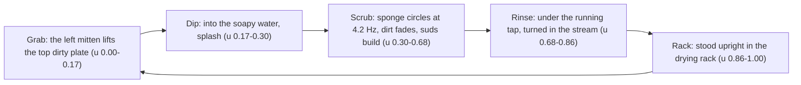

# Scene 001 · Locked in → the lioness → dishes → the idea fades

The spec for the 3D build of Scene 001: a 13 s wordless short, built with Blender (characters, sets
and props exported as GLB) and staged, lit and rendered in Three.js. Every number below comes from the
current code:

| What | Where |
|---|---|
| Timeline, cues, bulb curve, cameras, light moods | [`scene001.js`](../src/scenes/scene001.js) |
| Choreography (Tim, the lioness, GuoGuo, FX) | [`director.js`](../src/scenes/director.js) |
| The dish cycle (beats 3–4) | [`dishwash.js`](../src/scenes/dishwash.js) |
| Set wrappers (door, chair, screen, plates, foam, tap, splashes) | [`office.js`](../src/sets/office.js), [`kitchen.js`](../src/sets/kitchen.js) |
| Graphic FX, bulb | [`fx.js`](../src/props/fx.js), [`bulb.js`](../src/props/bulb.js) |
| Bank items (Blender scripts) | [`items/`](../items/) |
| Look A renderer | [`look.js`](../../../infra/web/look.js) |

Units are metres and seconds. Coordinates are Three.js: x right, y up, z toward the open front of the
dollhouse (the camera side).

## Premise

Tim is locked in, building an app. His wife, a fierce lioness, bursts into the room and tells him to
do the chores: wash the dishes. While he washes up, the light bulb above his head (his idea) fades out.

**Design picks:**
- the lioness is **lioness A**, a full lioness in an apron;
- the idea is a **light bulb** (a campfire was the other option);
- the bulb fades slowly and ends in a snuffed-out smoke wisp.

**Narration** (Tim's voice, placeholder; never drawn on screen):
1. "I was locked in, building an app with my agent…"
2. "…then the lioness arrived."
3. "So I did the dishes."
4. "And the idea? Gone."

## Rules that apply to every scene

| Rule | Meaning for the 3D build |
|---|---|
| **Wordless** | No text drawn anywhere. Screens show bars and icons, bubbles hold pictograms, cards hold icons. Words live only in the narration and subtitles |
| **Deterministic** | Rendering is a pure function of time `t`: no wall clock, no unseeded randomness, no state carried from the previous frame. The same `t` renders the same pixels on the same machine, in any frame order |
| **GuoGuo in every scene** | The king-penguin plush appears somewhere in every scene as an easter egg (peeking, reacting in the background) |
| **Locked look** | "3D toy, Animal Crossing smooth" (Look A): soft vinyl characters, a dollhouse room, a free camera, face-decal expressions |
| **Picks are frozen** | Randomness belongs at design time: generate options, pick one, freeze the chosen one in the bank (GLB + sha256 + provenance in `manifest.json`) |
| **Camera** | Must pan, tilt and zoom easily (the player has a free camera next to the shot camera) |

References: *Animal Crossing: New Horizons* and *Sylvanian Families*. Express the human through
expression and gesture, "more like a cute stickman".

## Timeline (13 s, 4 beats, 30 fps = 390 frames)

| # | Time | Set | Camera | What happens | Bulb level |
|---|---|---|---|---|---|
| 1 | 0.0–3.5 | office | `front34_push` | **Locked in.** Tim types at the desk, focused, in a warm glow; the bulb above his head is bright | 1.0 |
| 2 | 3.5–6.2 | office | `two_shot` (3 shots) | **Break-in.** The door bursts open with dust and speed lines. The lioness walks in, stops and points at Tim; a bubble shows dirty plates and "!", with an anger mark. Tim jumps into shock and the bulb flickers | flickers 0.35–0.85 |
| 3 | 6.2–9.7 | kitchen | `side_truck` + hands insert | **Dishes.** Tim washes plates at the island, glum. Stack 6 → 3, rack 0 → 3; a cool glow replaces the warm one and the bulb dims | 0.75 → 0.3 (linear) |
| 4 | 9.7–13.0 | kitchen | `close_push` | **Idea gone.** Tim gives up and slumps; the plate slides back into the water. The bulb flickers once, goes out and lets off a smoke wisp, then a ✗-bulb card pops in | 0.3 → 0.05 → out |

### Cues (absolute seconds)

| t | Cue | Event |
|---|---|---|
| 1.25, 3.02 | `timBlinks` | Tim blinks |
| 3.05 | `lionListen` | The lioness's ears flick behind the door |
| 3.43 | `lionBrace` | She braces against the door |
| 3.55 | `doorOpen` | **The door bursts open** (swings 92° in about 0.25 s, overshoots and rings on its spring; dust). GuoGuo is startled. The room light snaps from the focus mood back to daylight |
| 3.60 | `lionMove` | She walks 1.7 m to `doorway_in` in 0.9 s (see [The lioness](#the-lioness-lioness-a)) |
| 3.62 | `speedLines` | Speed lines behind her (0.62 s) |
| 3.72 | `timTurn` | Tim's chair swivels 30° toward the door; his head turns to follow her |
| 3.75 | `timShock` | **Shock:** `sit_shock`, a 0.045 m hop off the seat with a lean back, trembling hands, the chair rolls back 0.1 m, a sweat drop; GuoGuo flinches (3.78) |
| 3.85 | `bulbFlicker` | The bulb flickers (seeded table, levels 0.35–0.85) until the cut to the kitchen |
| 4.42 | `lionTurn` | She turns to near profile (80°) so the point reads side-on; her head turns 30° toward the camera |
| 4.50 | `lionAkimbo`, `bubble`, `anger` | She settles; the far paw goes on her hip; the bubble (dirty plates + "!") and the anger mark pop in |
| 4.55 | `lionPoint` | She points at Tim (anticipation → thrust; the arm is aimed at his head); her face turns angry |
| 4.97, 5.21 | `jabs` | Two jabs; the "!" pulses with each |
| 5.45 | — | Camera cut to Tim's shock close-up |
| 6.20 | — | Cut to the kitchen, mid-scrub on the first plate |
| 6.62 / 7.78 / 8.95 | — | A clean plate goes into the rack: rack 1 / 2 / 3 |
| 6.78 / 7.95 / 9.12 | `stackSteps` | Tim lifts the next plate off the stack: stack 5 / 4 / 3 |
| 7.05–7.95 | — | Hands insert (plate 1: scrub → rinse → rack) |
| 7.45, 8.95 | `timBlinks` | Tim blinks |
| 9.80 | `timDeflate` | **Deflate:** a small inhale, then the slump (0.4 s, `stand_sink_idle`); face deflated. The plate slips back into the water (9.84, 0.42 s, splash); the tap goes off (9.85); the sponge drops in (9.92), splashes and floats; both mittens come to rest on the island edge |
| 10.35 | `bulbBlink` | One blink back up to 0.35 (0.12 s) |
| 10.60 | `bulbOut` | The bulb goes out: it droops and tilts over 0.5 s, smoke puffs rise and a wisp curls up; GuoGuo flinches; the light dims further |
| 11.30 | `card` | The ✗-bulb card pops in at screen position (0.64, 0.30) |
| 11.85 | `timBlinks` | Tim blinks |

### The dish cycle (beats 3–4)

One cycle per plate, every P = 3.5 s / 3 ≈ 1.17 s. With u = seconds since the plate left the stack,
the plate is handled for 1.0 s; the rest of the period is the left mitten reaching for the next plate.

- **The same plate travels stack → hand → rack.** The stack holds 6 dirty plates; the top three are
  washed in turn (stack 6 → 3), and one more plate is already in Tim's hands when beat 3 opens. The rack
  fills 0 → 3.
- **The tap** turns on just before each rinse (u 0.66) and off as the plate leaves for the rack; the
  stream lands on the plate face when the plate is under it, otherwise in the water.
- **Arms:** analytic two-bone IK puts the left mitten on the plate rim and the right mitten (with the
  sponge) on the plate face; the torso leans into far reaches (rack, rinse). The held plate follows the
  actual mitten, so contact never breaks.
- **Dirt and suds:** the smudges fade to 10 % during the scrub and to 0 by the rack; a suds dab grows on
  the face while scrubbing and washes off under the tap. Every dip makes a splash ring, a water crown
  and droplets.
- **Beat 4:** the fourth plate never gets rinsed. On the deflate it slides back into the water, the
  tap goes off, the sponge drops in and floats with a small bob, and the mittens rest on the island edge.

### Beat-2 locked clip (8 s)

A single-shot version of beat 2 ships as a second scene ([`beat2.js`](../src/scenes/beat2.js), player
`?scene=beat2`). It shares the director with Scene 001 and serves as a look reference.

| t | Event |
|---|---|
| 0.0 | Tim types; GuoGuo watches from the shelf; the camera orbits in |
| 1.25 / 3.02 | Tim blinks |
| 1.9 | The lioness's ears flick behind the door |
| 2.2 | **The door bursts open** (spring ring, dust); GuoGuo is startled |
| 2.21–2.5 | She braces through the door, then straightens up |
| 2.3–3.0 | She walks to just inside the door (the camera pans to the door, then to her) |
| 2.75 / 2.9 | She turns toward the camera / puts the far paw on her hip |
| 3.0 | She points and jabs twice (3.42, 3.66); the "!" pulses |
| 3.12 | The bubble pops in: dirty plates + "!" |
| 3.78 / 3.9 | Tim's chair turns / **shock** (hands up, jolt, chair rolls back, sweat drop, GuoGuo flinches); the camera zooms in |
| 3.9–5.5 | The bulb flickers out (0.1, 0.9, 0.15, 0.85 … 0); smoke |
| 4.61 | The lioness blinks |
| 4.85 | The camera tilts up to the dying bulb |
| 5.6–7.6 | The camera re-bases and orbits out to a wide shot |

## Look A (render settings)

| Setting | Value |
|---|---|
| Frame | 1920 × 1080, 30 fps |
| Tone mapping | Neutral, exposure 0.95 (base; the moods below override it) |
| Background / fog | `#e8e0d4`, fog from 13 m to 30 m |
| Environment | `RoomEnvironment` PMREM (sigma 0.04), intensity 0.3 |
| Shadows | PCF; a 4096 key-light map with extent 5.5 and radius 5 |
| Lights | hemisphere `#fff4e4`/`#cdb79a` at 0.6 · key `#fff0dc` at 2.3 from (3.2, 6.5, 5.5) · rim `#e9eeff` at 0.55 from (−3, 4, −5) · a practical spot per mood · warm hall point light · faint blue laptop light |
| Post | MSAA ×4 · GTAO (radius 0.32, 16 samples, blend 0.8) with a seeded denoise · bloom 0.42 / radius 0.45 / threshold 1.6 (only the bulb blooms) · vignette 0.16 · no grain |
| Character material ("soft vinyl") | `MeshPhysicalMaterial`: roughness 0.5, clearcoat 0.22 (roughness 0.5), sheen 0.15 (roughness 0.8) |
| Prop material | roughness 0.62, with a wood-grain map on wood parts |
| Face decals | roughness 0.45; a canvas-drawn texture on a front-projected shell, swapped per expression |

Camera: perspective, near 0.05, far 60; the field of view runs 20°–36° per shot.

### Light mood per beat

| Mood | When | Exposure | Background | Key | Rim | Practical spot | Vignette |
|---|---|---|---|---|---|---|---|
| `focus` | beat 1 | 0.88 | `#cdbfab` | `#ffd9a8` 1.2 | warm `#ffd09a` 1.0 | warm `#ffcf8f` 12 on the desk | 0.36 |
| `office` | from the burst (3.55, 0.18 s ease + a short exposure flash) | 0.95 | `#e8e0d4` | `#fff0dc` 2.3 | `#e9eeff` 0.55 | off | 0.18 |
| `kitchen` | beat 3 start | 0.86 | `#cfd5db` | cool `#dde7ff` 1.75 | low blue back light `#a9bfe6` 2.4 | cool `#bcd2f2` 3.5 on the sink | 0.28 |
| `gone` | blended in from 6.6 to 10.3 | 0.74 | `#b3bac3` | `#e2e8f5` 1.25 | `#9fb3d8` 2.8 | `#a9c2e6` 3.0 | 0.42 |
| `out` | after the bulb dies (10.6, 1.4 s) | 0.64 | `#a1a8b1` | `#dde3f0` 1.05 | `#97a9cc` 2.5 | `#a3bde3` 2.6 | 0.50 |

So: a warm, focused office → daylight snaps back on the burst → a cool kitchen that keeps dimming as the
idea dies → extra dim once the bulb is out.

## Characters

### Tim (the host)

An Animal Crossing-style chibi villager as a soft vinyl toy: a big head (head centre at 1.08 m) on a
small body, about 1.5 m tall. Script: [`tim.py`](../items/tim.py), hair in
[`tim_hair.py`](../items/tim_hair.py).

| Part | Description |
|---|---|
| Signature features | **Hair H3, a textured crop**: one sculpted shell split into clumps by grooves, plus loose locks; a high near-straight fringe, a soft M at the temples, short tight sides tapering to the nape; dark brown-black with a strand normal map. **Thin round wire glasses** as real geometry (rings 0.092 m) with temple arms that follow the head to the ears |
| Body | A navy hoodie with a hood ring, a kangaroo pocket and splayed drawstrings; dark cuffs and hem; taupe pants; cream shoes with tan soles; ears; soft mitten hands with a thumb |
| Rig | `root`, `hips`, `torso`, `neck`, `head`; two-joint arms (`upperarm`, `forearm`, `hand`, plus a `grip` point) and legs (`thigh`, `shin`, `foot`). The swivel chair (`chair_swivel`, `chair_base`) is part of the office set |
| Actions | `sit_type` (1.6 s loop: typing, head bob, foot swing), `sit_idle`, `sit_shock` (0.6 s: hands up, jolt), `stand_idle`, `stand_wash` (1.0 s), `stand_sink_idle` (slumped, mittens on the island edge). In the kitchen the arms are re-solved per frame by the dish cycle's IK |
| Expressions | `deadfish` (the default face: heavy flat lids, pupils hanging under them, a flat mouth), `focused` (beat 1), `shock` (white shock eyes, open mouth, gloom lines; with the sweat drop), `glum` (beat 3), `deflated` (beat 4), `talking`; each with a `_blink` variant |
| Staging | The face is lifted toward the lens in each beat so the expression reads (9° focused, 18° glum, 24° deflated) |

Palette: skin `#f4dcc6` · hoodie `#36435e` / `#2c374d` · drawstring `#efe7d8` · pants `#8f8576` ·
shoe `#ece5d8` · sole `#a08d78` · hair `#2b241f` · wire `#3b3633` · ink `#2a2421` · mouth `#6b3f36` ·
blush `#e49286` · gloom `#7891be` · sweat drop `#a9cfe3`.

### The lioness (lioness A)

A Sylvanian Families-style flocked mother figure, 1.58 m tall. Scripts:
[`lioness.py`](../items/lioness.py), walk in [`lioness_walk.py`](../items/lioness_walk.py).

| Part | Description |
|---|---|
| Build | Organic parts (head and muzzle, body, limbs, tail tuft, nose) are smooth implicit surfaces with clean colour edges; clothes are parametric cloth surfaces |
| Lion cues | **No mane.** A wide flat-crowned feline head with soft cheek ruffs, a real muzzle (two whisker pads, a chin, a nose bridge), whisker dots and whiskers, a pink-brown nose, side-set round ears with dark backs, cream under-eye patches and a tufted tail |
| Clothes | A lavender bell dress with natural folds; a cream apron with a gingham hem, a bib, crossed straps, a pocket and a back bow |
| Rig | Root yaw, hips, body, neck, two-joint arms and legs, tail, ears; a pointing finger on the right paw (`finger_R`). The point is aimed at Tim's head at runtime (two passes of one-bone aim on the shoulder and elbow) |
| Actions | `stand` (2.0 s, tail sway), `listen` (ear flick), `brace`, `upright`, `akimbo` (far paw on the hip), `point` (0.9 s), `walk` (1.0 s) |
| Expressions | `stern` (flat lids, inner corners lower, brows slanting to the nose), `angry` (from the point on); each with a `_blink` variant |

**The walk** is built from key poses per step (contact → down → passing → up) with eased
interpolation and foot-locked legs: rocker feet that strike heel-first, roll flat and peel off the toes;
two-bone leg IK; pelvis bob, weight shift and yaw; counter-rotating shoulders; arms, tail and ears with
overlap. One cycle is 1.0 s = 2 steps and covers a **stride of 0.66 m**. The director drives the phase
from the distance walked, so the planted foot never slides.

**The entrance:** she starts just outside the door (clear of its swing), walks **1.7 m over 0.9 s**
(smoothstep, about 2.6 cycles) to `doorway_in`, settles with a small hip dip, then turns, puts a paw on
her hip and points.

Palette: fur `#d5b186` / light `#e3c6a0` · muzzle `#f3e7d2` · nose `#b27c6c` · inner ear `#efd9c0` ·
ear back `#6e5442` · tail tuft `#7a5a40` · dress `#a8a8c6` · apron `#f7f1e6` with a
`rgba(201,139,124,0.5)` check · brow `#8a6446`.

### GuoGuo (the mascot easter egg)

Tim's own king-penguin hand-puppet plush. Child-size: 0.50 m seated, about 0.66 m standing. Script:
[`guoguo.py`](../items/guoguo.py).

| Trait | Description |
|---|---|
| Body | Head and body are **one continuous loft with no neck**, traced from front and side silhouettes |
| Fur | Shell fur (22 shells, 0.015 m) with a per-vertex pile length: long on the body, shorter on the head, shortest round the eyes and beak root; colour borders are soft and tufted |
| Head | Black, down to the flipper-top line all round |
| Beak | Long and slender matte felt, tilted 14° down, with an orange stripe on the lower mandible |
| Eyes | Glossy blue glass beads, flush on the sides of the head, with big pupils; white rings show only while startled |
| Ear patches | Comma-shaped orange patches, low on each side of the head |
| Throat | A **yellow V-shaped bib** that fades to cream toward its tip |
| Body colours | A full white front, medium-grey back and sides |
| Flippers | Chunky stuffed flippers stuck out sideways: white in front, grey behind |
| Feet | Stubby black felt feet |
| Rig and actions | `root`, `body`, `head`, flippers, feet · `seated_idle` (3.0 s: head wander, breathing, flipper paddle), `startled` (1.6 s: hop, flap, squash, jiggle, wide eyes), `flinch` (0.6 s), `look_off` |
| Placement | **Office:** on top of the bookshelf at its left end (x ≈ −0.66, y 1.04, z −1.72), peeking out left of Tim; his head tracks Tim → the door → the lioness → Tim. **Kitchen:** on the back counter to the right of the window (1.05, 0.62, −1.62), head tilted |

Palette: white `#f3f2ee` · grey `#9b9da0` · black `#1b1b1e` · bib `#f4e638` · orange `#f56a1c` ·
iris `#2f78bd` · pupil `#0b0b0d`.

## Sets

Both sets are Sylvanian-style **dollhouse cutaways** on a large round tabletop, floor at y = 0, walls
2.3 high and 0.1 thick, sharing one material kit ([`dollhouse_kit.py`](../items/dollhouse_kit.py)).

### Office + hall (beats 1–2)

Script: [`office.py`](../items/office.py), furniture in [`office_props.py`](../items/office_props.py).

| Element | Size / place |
|---|---|
| Room | x −2.6 … 2.4, z −1.9 … 1.25 |
| Framing | A **full-depth right wall**, a **ceiling** at y 2.3 with **three joists** (x −1.55, −0.35, 1.25) and a **wooden fascia** across the open front, plus posts capping the wall ends. The open front becomes a proscenium, so wide shots never look past the set. None of these cast shadows |
| Door | In the left wall, z −1.125 … −0.275, 1.75 high; a white raised-panel door with brass knobs, hinged at (−2.55, 0, −1.10). It swings into the room |
| Hall | Beyond the door: x −4.3 … −2.6, z −1.75 … 0.35, with checked wallpaper, a warm pendant light and vases |
| Window | Back wall, x 1.45 … 2.15, y 0.95 … 1.75: a sky, clouds and hills, gingham curtains on a wooden rod |
| Desk | x 0.275 … 1.425, z −0.25 … 0.30, top 0.55. Holds a laptop, a mug, a notebook and a succulent |
| Laptop | Lid hinge at (0.85, 0.568, 0.005), tilted back 0.26 rad. The screen is a wordless code editor: pastel code bars fill while Tim types |
| Swivel chair | At (0.85, 0, −0.5), behind the desk facing the camera; a mustard pad on a grey five-star frame; it swivels and rolls |
| Bookshelf | x −0.89 … −0.01 against the back wall; 1.02 high, 0.41 deep, 3 shelves of seeded pastel books, dressing on top |
| Other dressing | A floor plant, a round braided rug (radius 0.85) under Tim, a wall clock on the left wall, a landscape painting on the back wall |
| Walls / floor | Cream wallpaper with small flower dots, a sage wainscot, cream trim, wooden beams; warm wooden planks |

| Spot | Position | Yaw | Used for |
|---|---|---|---|
| `spot_desk_seat` | (0.85, 0, −0.5) | 0° | Tim typing |
| `spot_doorway_out` | (−3.25, 0, −0.7) | 90° | The hall, outside the door |
| `spot_doorway_in` | (−1.15, 0, −0.1) | 90° | Where the lioness stops |
| `spot_shelf_top` | (−0.26, 1.04, −1.72) | 15° | GuoGuo (shifted 0.4 m left in the scene) |
| `spot_turntable` | (1.85, 0, 0.65) | 0° | Design views |

Palette: wall `#efe5d1` · flower dots `#d9ad9f`/`#a9b897` · wainscot `#b9c3a8` · trim `#f5efe3` ·
floor `#c9a47c` · beam `#b98e67` · exterior `#e3d5bf` · door `#f2ebdd` · brass `#c8a66a` · hall wall
`#efdcb4` · desk `#d9b68e` / `#b8916b` · laptop `#ccc8c1` / `#5a5753` · screen `#2f3546` with code bars
`#9fc7e6 #b7b2e6 #a6d0a8 #efb995` · chair pad `#d2b06f` · frame `#6c6661` · shelf `#cfa77f` · plant
`#93a77f` / `#7c9169` · pot `#c99a7a` · tabletop `#d8ccba`.

### Kitchen (beats 3–4)

Script: [`kitchen.py`](../items/kitchen.py). Tim washes up **facing the camera** at a central island;
the window is behind him.

| Element | Size / place |
|---|---|
| Room | x −2.2 … 2.2, z −1.9 … 1.25, open at the front and on the right |
| Island | x −0.55 … 1.15, z −0.25 … 0.30, **top at 0.50**: Tim's working height, so his short arms reach into the basin. Drawers and doors on the camera side; a brass towel bar with a gingham tea towel on the right end |
| Basin | Centre (0.30, −0.05), a rounded rectangle 0.38 × 0.30 inside, 0.14 deep. **Soapy water** at y 0.468: a glossy translucent surface over a cloudier layer 2.5 cm down, so a dipped plate shows through. **Merged foam:** one lumpy mass of small bubbles, tallest at the far end, parted around the work patch; it breathes gently, and small iridescent bubbles rise and pop. A few suds spilled on the counter |
| Tap | A **low swing-arm faucet** at the basin's left end (x ≈ 0.06, z −0.10): a short column, an arm about 0.175 above the counter and a down-turned spout over the rinse spot (x 0.215); cross-handle taps either side. It stays below Tim's face from the front cameras |
| Dirty plate stack | (0.635, 0.50, −0.13), on Tim's left: 6 plates, pitch 0.0215 |
| Drying rack | Wooden dowel rack, x 0.753 … 0.897, centred on z −0.10; three slots at x 0.785 / 0.825 / 0.865 |
| Also on the island | A soap bottle |
| Back run | Counter top 0.62 along the back wall (z −1.85 … −1.30) with an oven and hob, a kettle, upper cabinets, a tiled backsplash, open shelves (canisters, jars, bowls, teapot, mugs, herbs) and a utensil rail |
| Window | Back wall, x 0 … 0.8, y 0.95 … 1.65, with a herb pot on the sill |
| Dressing | A rounded retro fridge on the left wall with a crayon drawing, a wall clock, a plate rail with three decorative plates, a floor plant, a fruit bowl and a cutting board |
| Floor | Soft checker of glazed tiles (cream / sage) |

| Spot | Position | Yaw | Used for |
|---|---|---|---|
| `spot_sink` | (0.36, 0, −0.42) | 0° | Tim at the island (beats 3–4) |
| `spot_guoguo` | (1.05, 0.62, −1.62) | −15° | GuoGuo on the back counter |
| `spot_plate_stack` | (0.635, 0.50, −0.13) | 0° | Bottom of the dirty stack |
| `spot_rack` | (0.825, 0.50, −0.10) | 0° | The drying rack |
| `spot_rack_1/2/3` | x 0.785 / 0.825 / 0.865, y 0.516, z −0.10 | 90° | Rack slots; an upright plate's centre sits at y 0.627 |

Hooks: `faucet_spout`, `sink_foam` / `sink_foam_base`, `sink_water` / `sink_water_deep`,
`light_window`, `clock_hour` / `clock_minute`.

Palette: the office's wall, trim, floor, wood and brass, plus cabinet `#f2ebdd` · cabinet fronts
`#b9c3a8` · kick `#a3ad92` · sink `#f5f2ea` · tile `#f5efe3` · floor checks `#f1e8d8` / `#b9c3a8` ·
enamel `#f7f2e8` · coral `#d9917c` · fridge `#ecc8ba` · water `#e4f1f6`.

## Props and graphics

| Item | Source | Description |
|---|---|---|
| **Idea bulb** | [`bulb.py`](../items/bulb.py) + [`bulb.js`](../src/props/bulb.js) | Frosted pear-shaped glass on a threaded screw base with a coiled filament, 0.25 m tall. Floats 0.76 m above the head, drifts (bob 0.025, tilt 0.05), has a glow sprite, rays above level 0.5 and a level `b` from 0 to 1 (lit above 0.05). **Out:** it droops and tilts over 0.5 s, then smoke puffs rise and a snuffed-out wisp curls. Glass `#fff6dc` lit / `#e2ddd3` off, emissive `#ffe2a0`, screw `#b8b2a8`, ray `#f3d58e`, smoke `#4f4a45` |
| **Plates** | [`dishes.py`](../items/dishes.py) | Ceramic plate, diameter 0.222, 0.018 tall, in a dirty version (sauce smudges, crumbs) and a clean one; the wash plates cross-fade from dirty to clean |
| **Sponge** | [`dishes.py`](../items/dishes.py) | Yellow with a green scour pad, 0.10 × 0.045 × 0.066; foam on its front end puffs up while scrubbing |
| **Suds** | [`dishes.py`](../items/dishes.py) | `suds_puff` (~0.07 across) and `suds_dab` (~0.055, clings to a plate face) |
| **Water** | [`kitchen.js`](../src/sets/kitchen.js) | The tap stream (falls in from the spout, its tail falls after it when it turns off), splash rings with a water crown and droplets, rising bubbles |
| **Speech bubble** | [`fx.js`](../src/props/fx.js) | A billboard beside the lioness's head that bobs and pops in: a dirty-plates pictogram and a red "!" (`#c4614e`) that pulses with the jabs |
| **Anger mark** | [`fx.js`](../src/props/fx.js) | An Animal Crossing-style vein mark by the lioness's head |
| **Speed lines** | [`fx.js`](../src/props/fx.js) | Ink streaks behind the lioness as she bursts in (0.62 s) |
| **Focus glow** | [`fx.js`](../src/props/fx.js) | Warm halo on Tim's head in beat 1 (`#ffc47a`, fades on the burst); cool halo in beats 3–4 (`#5f86c4` → `#7a8aa6`, shrinking 2.9 → 2.7, dimmer after the bulb dies) |
| **Sweat drop** | [`fx.js`](../src/props/fx.js) | Tim's shock: pops in and slides down |
| **Door dust** | [`fx.js`](../src/props/fx.js) | A floor burst swept along the door's swing, a gust through the doorway and drifting motes |
| **✗-bulb card** | [`fx.js`](../src/props/fx.js) | An icon card, a crossed-out bulb, that pops in at screen position (0.64, 0.30) |
| **Laptop screen** | [`screen.js`](../src/props/screen.js) | Wordless code editor: pastel bars that fill while Tim types |

## Cameras

All shots are functions of `t` in [`scene001.js`](../src/scenes/scene001.js). Framings were checked so
no frame edge looks past the set.

| Beat | Shot | Camera |
|---|---|---|
| 1 | `front34_push`: the whole dollhouse room → ¾ front on the focused face, GuoGuo left of frame, the bulb above Tim | Position (1.0, 1.3, 5.8) → (1.65, 1.72, 3.45), target (0.45, 1.28, −0.42) → (0.57, 1.29, −0.41), FOV 26.5° → 22°, smootherstep over 0–3.4 s |
| 2A | **Wide burst:** the door seen nearly square-on, the lioness and Tim | Position (2.5, 2.4, 2.7), target (0.093, 1.142, −0.273), FOV 26°; a 12 % FOV punch-in on the burst with a spring settle and a decaying shake |
| 2B | **Side-on two-shot of the point:** the lioness ¾ on the left third, her arm in profile, Tim on the right | Eases from 2A over 4.2–4.7 s to position (0.6, 2.35, 4.2), target (−0.245, 1.057, −0.355), FOV 30° |
| 2C | **Hard cut to Tim's shock close-up** at 5.45: face on the right third looking off-left, raised hands, the flickering bulb above | Position (1.85, 1.92, 4.75) → (1.8, 1.9, 4.6) with a spring punch-in and shake, target (0.35, 1.064, −0.578), FOV 21.5° → 20° |
| 3 | `side_truck`: front ¾ over the island; Tim's glum face, the plate and suds, the shrinking stack, GuoGuo behind | Orbit around a target (0.3, 1.04, −0.33) → (0.34, 1.08, −0.38): azimuth 32° → 20°, elevation 15° → 12°, distance 3.6 → 3.2, FOV 30° |
| 3 insert | **Hands insert, 7.05–7.95:** high front-right on the mittens, sponge and plate over the soapy water, the spout and the stack framing it (scrub → rinse → rack) | Target ≈ (0.41, 0.55, −0.13); azimuth 36° → 32°, elevation 40° → 38°, distance 0.8 → 0.74, FOV 36° |
| 4 | `close_push`: **frontal push-in.** Opens a touch wider so the plate sliding into the water and the sponge drop read, holds 0.45 s, then pushes in to head, slumped shoulders and bulb; GuoGuo on the right, the ✗ card upper right | Target (0.6, 1.16, −0.32) → (0.62, 1.25, −0.32): azimuth 30° → 27°, elevation 14° → 13°, distance 3.45 → 2.7, FOV 31° → 29°, from 10.15 s to the end |

The beat-2 locked clip uses one continuous orbit: azimuth 40°, elevation 27°, distance 10.2 easing to
6° / 12° / 5.8 over 2.25 s; the target pans to the door (2.3 s), the lioness (2.85 s) and Tim
(3.45 s); FOV 30° → 12.5° on the shock (4.0 s); tilt up to the bulb (4.85 s); re-base and orbit out to
−13° / 4° / 4.9 (5.6–7.6 s).

## Built assets

Each GLB is produced by a deterministic Blender script and recorded in
[`manifest.json`](../public/assets/manifest.json) with its sha256 and provenance.

| Asset | Bank file (under `public/assets/`) | Size | Item script (under `items/`) |
|---|---|---|---|
| Tim | [`characters/tim.glb`](../public/assets/characters/tim.glb) | 2.9 MB | [`tim.py`](../items/tim.py), [`tim_hair.py`](../items/tim_hair.py) |
| Lioness | [`characters/lioness.glb`](../public/assets/characters/lioness.glb) | 3.1 MB | [`lioness.py`](../items/lioness.py), [`lioness_walk.py`](../items/lioness_walk.py) |
| GuoGuo | [`characters/guoguo.glb`](../public/assets/characters/guoguo.glb) | 1.3 MB | [`guoguo.py`](../items/guoguo.py) |
| Office + hall | [`sets/office.glb`](../public/assets/sets/office.glb) | 3.2 MB | [`office.py`](../items/office.py), [`office_props.py`](../items/office_props.py), [`dollhouse_kit.py`](../items/dollhouse_kit.py) |
| Kitchen | [`sets/kitchen.glb`](../public/assets/sets/kitchen.glb) | 4.3 MB | [`kitchen.py`](../items/kitchen.py), [`dollhouse_kit.py`](../items/dollhouse_kit.py) |
| Idea bulb | [`props/bulb.glb`](../public/assets/props/bulb.glb) | 0.1 MB | [`bulb.py`](../items/bulb.py) |
| Dishes (plates, sponge, suds) | [`props/dishes.glb`](../public/assets/props/dishes.glb) | 0.5 MB | [`dishes.py`](../items/dishes.py) |

The bubble, anger mark, speed lines, glows, sweat drop, dust, ✗ card, water and laptop screen are
drawn at runtime in Three.js (see [Props and graphics](#props-and-graphics)).
